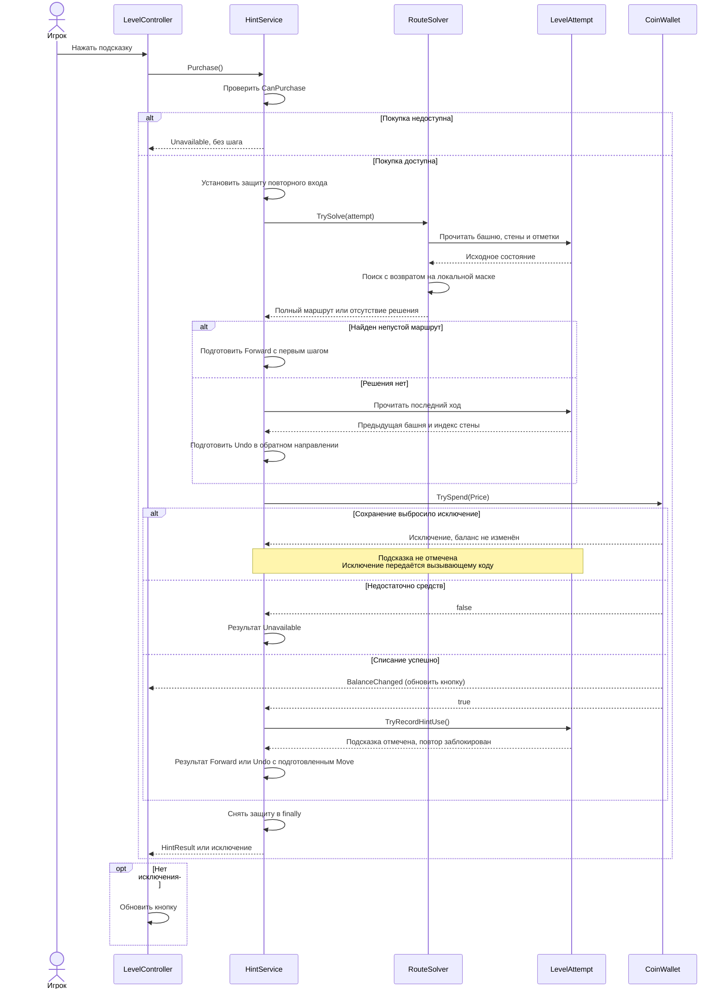

# Поиск решения для покупки подсказки

## Контекст и проблема

Задача 7 из [плана монет и метаигры](../../plans/2026-11-08-coins-meta-game.md) заменяет временную покупку подсказки без решения. Сейчас `HintService` проверяет деньги и доступность попытки, списывает цену и отмечает использование подсказки даже в тупике. `LevelRun` хранит стены, текущую башню и историю; `LevelAttempt` управляет бонусом и блокировкой повторной покупки. Стены неориентированные, а существующий `Move` уже содержит направленные `From`, `To` и `WallIndex`.

Словарь и ADR в проекте пока отсутствуют. Здесь «решение» означает полный маршрут по оставшимся стенам, а «шаг подсказки» — первый переход этого маршрута либо направление отмены последнего хода. Тупик включает ситуацию, где соседняя свободная стена есть, но завершить весь уровень уже невозможно.

## Цели и границы

- Найти маршрут от текущей башни через каждую оставшуюся стену ровно один раз, сохранив исходные индексы стен и состояние попытки.
- При покупке выдать первый шаг решения, а если решения нет — направление к предыдущей башне по той же цене, без перемещения игрока.
- Сохранить цену, бонус x1 после покупки и действующие правила повторной покупки, отмены и победы.
- За рамками: подсветка, стрелки, сообщение об отмене/перезапуске из задачи 8, изменения сцен и сохранений, генератор графов и оптимизация для больших уровней.

## Рассмотренные варианты

1. **Поиск с возвратом на локальном состоянии.** Соответствует плану, прост для нынешних маленьких графов, естественно возвращает направленные шаги. В худшем случае перебор экспоненциальный.
2. **Алгоритм построения эйлерова пути.** Эффективнее на больших графах, но требует отдельной проверки достижимости всех оставшихся рёбер и корректного начала пути; для текущего масштаба не нужен и отличается от согласованного плана.
3. **Перебор через `TryMove`/`TryUndo` живой попытки.** Переиспользует переходы, но меняет историю, признаки отмены и результат попытки. Неприемлем для чтения состояния при покупке.

Выбран первый вариант. Поиск не использует команды изменения попытки.

## Решение

### Доступ к графу и поиск

`LevelRun` предоставляет `Walls` как неизменяемое представление собственного списка стен; `LevelAttempt` делегирует это свойство. Представление не должно позволять привести его к изменяемому исходному списку. Порядок стен совпадает с тем, по которому уже работают `IsWallTraversed`, `Move.WallIndex` и представления поля. Не передаём второй независимый граф в `HintService`: это исключает рассогласование индексов с попыткой.

Добавляется чистый C#-компонент `RouteSolver` без Unity, кошелька и сохранений. Контракт `TrySolve` принимает `LevelAttempt` и возвращает признак существования решения и доступную только для чтения последовательность `Move`. `null` вместо попытки — ошибка аргумента. Отсутствие решения — обычный отрицательный результат с пустой последовательностью, а не исключение.

На входе поиск копирует текущую башню и маску пройденных стен; затем работает только с локальной маской и локальным списком шагов. Граф попытки неизменяем. Для каждой ещё не использованной стены, инцидентной текущей башне, поиск выбирает противоположную башню, отмечает индекс, добавляет направленный `Move` и рекурсивно продолжает. Если ветка не покрыла все оставшиеся стены, удаляет её шаг и снимает локальную отметку. Критерий успеха — число добавленных шагов равно числу оставшихся стен; посещённость башен не ограничивается.

Стены перебираются по возрастанию исходного индекса: результат воспроизводим, а выбор параллельных стен совпадает с `LevelRun.TryMove(destination)`, который использует первую свободную подходящую стену. Обратный проход по стене разрешён. Петля из башни в неё же не является допустимым переходом: её пропускаем, как и `LevelRun.TryMove`; оставшаяся петля делает полное решение невозможным. Несвязные оставшиеся компоненты также дают отказ. Новую валидацию ресурсов уровня эта задача не вводит.

Если оставшихся стен нет, поиск успешно возвращает пустое решение. Покупка завершённой попытки всё равно отклоняется до поиска. Непустой успешный результат гарантирует:

- первый `From` равен исходной текущей башне, каждый следующий `From` равен предыдущему `To`;
- каждый `WallIndex` относится к исходному графу, встречается один раз и не был пройден до поиска;
- направление шага соответствует концам стены;
- охвачены все оставшиеся стены.

Результат — отдельная коллекция, которую дальнейший поиск не меняет. История, текущая башня, отметки стен, время, признаки попытки и награда не меняются ни при успехе, ни при отказе. Кэш, асинхронность и ограничение числа итераций не добавляются.

### Контракт покупки

Добавляется неизменяемый `HintResult`: статус `Forward`, `Undo` или `Unavailable` и nullable-шаг `Move`. `Forward` и `Undo` обозначают успешные оплаченные покупки со шагом. `Unavailable` — отказ без шага и списания: нехватка денег, блокировка, завершение попытки или повторный вход. Полный маршрут остаётся результатом `RouteSolver`.

При непустом решении возвращается `Forward` с первым шагом. Если решения нет, сервис берёт последний элемент `History` и возвращает `Undo`: `From` — текущая башня, `To` — `From` последнего хода, `WallIndex` — индекс последней пройденной стены. Это рекомендация отменить ход, а не разрешение пройти использованную стену через `TryMove`. Автоматической отмены нет. Одна отмена не гарантирует появления полного решения. Покупка отмечает `UsedHint`, даёт x1 и блокирует повторную покупку так же, как обычная подсказка.

Согласованный инвариант: граф уровня всегда допускает полное решение из начальной башни. Поэтому при отсутствии решения в незавершённой попытке история гарантированно непустая и предыдущая башня существует. Отдельная ветка покупки для неразрешимого старта не нужна; проверка пригодности графов находится за рамками задачи.

Вместо булевого `TryPurchase()` сервис предоставляет `Purchase()` с результатом `HintResult`. Конструктор сервиса и его владение одной попыткой сохраняются; отдельный интерфейс solver и DI-инфраструктура не нужны. `CanPurchase` сохраняет текущий смысл: быстрая проверка денег, блокировки и завершения, без поиска. В тупике нажатие покупает указание на предыдущую башню. Отображение направления и отличия отмены от обычного шага относится к задаче 8.

Порядок покупки:

1. При недоступности вернуть `Unavailable` без поиска и побочных эффектов.
2. Установить существующую защиту `_isPurchasing` до поиска.
3. Найти полное продолжение текущей попытки. Подготовить `Forward` с первым шагом решения или `Undo` по гарантированно существующему последнему ходу, если решения нет.
4. Вызвать `CoinWallet.TrySpend(Price)`; при отказе вернуть `Unavailable`.
5. Отметить использование через `LevelAttempt.TryRecordHintUse`, затем вернуть подготовленный `Forward` или `Undo` со шагом. История и позиция игрока остаются прежними.
6. В `finally` снять `_isPurchasing` при любом исходе, включая исключение сохранения.

Вызовы синхронны на главном потоке. Существующее событие `BalanceChanged` приходит внутри списания: его обработчики обновляют UI, не меняют попытку и не выбрасывают исключения. Повторная покупка из обработчика отклоняется защитой. При этих условиях после успешной предварительной проверки отметка подсказки гарантированно разрешена. Добавление транзакций против произвольных мутаций попытки или исключений подписчиков не входит в задачу; это существующее ограничение сервиса.

Если сохранение кошелька выбрасывает исключение, оно передаётся вызывающему коду, баланс в памяти и попытка остаются прежними согласно текущему `CoinWallet`. Ошибка сохранения не маскируется обычным результатом покупки.

`LevelController.BuyHint` переходит на новый метод покупки и, как сейчас, обновляет кнопку. До задачи 8 он не сохраняет и не отображает полученный шаг. Успешный переход разблокирует покупку, неудачный тап и отмена — нет; новая попытка создаёт новый сервис. Победа запрещает покупки. Эти правила остаются в `LevelAttempt`.

### Последовательность взаимодействий

Диаграмма охватывает одно нажатие кнопки, поиск, списание и выдачу результата; отображение шага за её границей.

### Данные и совместимость

Форматы уровней, PlayerPrefs и сцены не меняются. `Move` используется повторно; новые данные результата существуют только в памяти. Булевый контракт покупки заменяется во всех текущих вызовах и тестах. Покупка без результата заменяется выдачей направления вперёд или назад, списание в тупике сохраняется. Для новых C#-ресурсов при реализации сохраняются Unity `.meta`; соблюдаются соглашения `AGENTS.md`.

## Тестирование

По ответу пользователя начинаем с юнит-тестов поиска. Новые интеграционные сценарии полного цикла и ручная проверка Play Mode отложены. Минимальный новый набор — EditMode-тесты через публичный `RouteSolver.TrySolve`:

- Полное покрытие с исходной позиции и после нескольких ходов: длина, непрерывность, уникальность индексов и соответствие оставшимся стенам. Включить обратное направление стены и повторное посещение башни.
- Возврат из неверной первой ветки: стены по порядку `A–D`, `A–B`, `B–C`, `C–A`, старт `A`; путь должен отложить `A–D` до конца.
- Тупик без свободного соседа и тупик со свободными соседями, но без полного решения (например, три луча из `A`); отдельно несвязные оставшиеся компоненты.
- Пустое решение на завершённом уровне, параллельные стены и непроходимая петля для согласованности с правилами `LevelRun`.
- Для успешного и неуспешного поиска сравнить состояние до и после: башню, историю, все отметки, время, `UsedHint`, `UsedUndo`, `CanUseHint` и награду. Повторный вызов даёт тот же маршрут и не меняет ранее выданную коллекцию.

Тесты проверяют свойства решения, а конкретный порядок — только там, где важны возврат и согласованность выбора параллельных стен. Они используют обычные маленькие графы в памяти, без загрузки сцен и кошелька.

Существующие [HintServiceTests](../../../Assets/Tests/EditMode/HintServiceTests.cs) адаптируются к статусам `HintResult`; тест `DeadEnd_PurchaseIsAllowedWithoutMovingPlayer` дополняется проверкой `Undo`, направления к предыдущей башне, индекса последней стены, однократного списания, `UsedHint` и блокировки покупки при неизменных истории и позиции. Этот контракт проверяется и для тупика со свободными соседями после хода. Графы тестов покупки должны быть решаемы из начальной башни; тупиковое состояние получают ходами игрока. При обычной покупке проверяются `Forward` и первый шаг решения. Прежние проверки цены, повторов, отмены, победы, ошибки сохранения и повторного входа сохраняются как регрессия. Пример работы с маршрутом — [LevelRunTests](../../../Assets/Tests/EditMode/LevelRunTests.cs).

После реализации 2026-11-09 прошёл весь EditMode-набор: 94 теста, включая 9 новых проверок поиска. Компиляция в Unity 6000.6.7f1 завершилась без ошибок и предупреждений. Это не доказывает работу подсветки или всей сцены; эти проверки остаются последующим задачам.

## Риски и выпуск

- Экспоненциальный перебор допустим для нынешних маленьких уровней. Перед увеличением графов требуется пересмотреть алгоритм; таймаут, выдающий ложный тупик, не добавляем.
- Рассогласование индексов предотвращает единый граф попытки; тесты проверяют исходные индексы и направление.
- До задачи 8 купленное направление ещё не отображается. Для `Undo` нужно будет указывать уже пройденную стену и отличать отмену от обычного шага.
- Изменение контракта покупки проверяется компиляцией и существующими тестами. Флаг функции и миграция не нужны. Откат к старой покупке уберёт выдачу направления, сохранив списание.

## Открытые вопросы

Блокирующих вопросов нет. Расширение тестирования до полного прохождения четырёх ресурсов уровня последовательными подсказками остаётся последующим этапом; сейчас пользователь предложил начать с юнитов поиска.

## Допущения агента

- `CanPurchase` не запускает поиск; в тупике кнопка остаётся доступной до нажатия.
- Для доступа к графу достаточно read-only `Walls` в `LevelRun` и `LevelAttempt`; отдельный тип снимка или интерфейс поиска не нужен.
- Статусы `Forward` и `Undo` различают два вида оплаченной подсказки, `Unavailable` обозначает отказ.
- Указание на предыдущую башню означает рекомендацию отменить последний ход. Отмена по-прежнему не разблокирует повторную покупку: потребуется успешный ход либо новая попытка.
- Возвращается первое найденное решение по порядку стен, без ранжирования маршрутов.
- Пустой граф означает успешное пустое решение solver, но не покупку подсказки.
- Адаптация существующих тестов покупки и их регрессионный запуск входят в минимальный объём наряду с новыми юнит-тестами поиска.
- Обработчики изменения баланса остаются UI-обработчиками без мутаций попытки и исключений.

Отдельный ADR не предлагается: выбор локального алгоритма и результата покупки легко обратим, то есть не проходит критерий дороговизны изменения из скилла `domain-modeling`.

Диаграмма встроена в документ; её следует открывать в Markdown-просмотрщике с поддержкой Mermaid. Выполнена содержательная сверка шагов с текстом; CLI-рендерер Mermaid недоступен, инструментальная и визуальная проверки не выполнены.

Обновлённый контракт с оплаченной подсказкой отмены прошёл повторную независимую проверку реализуемости: блокирующих вопросов и существенных противоречий не найдено. Диаграмма проверена по исходнику без визуального рендера. Производительность на ресурсах уровней не измерялась.
